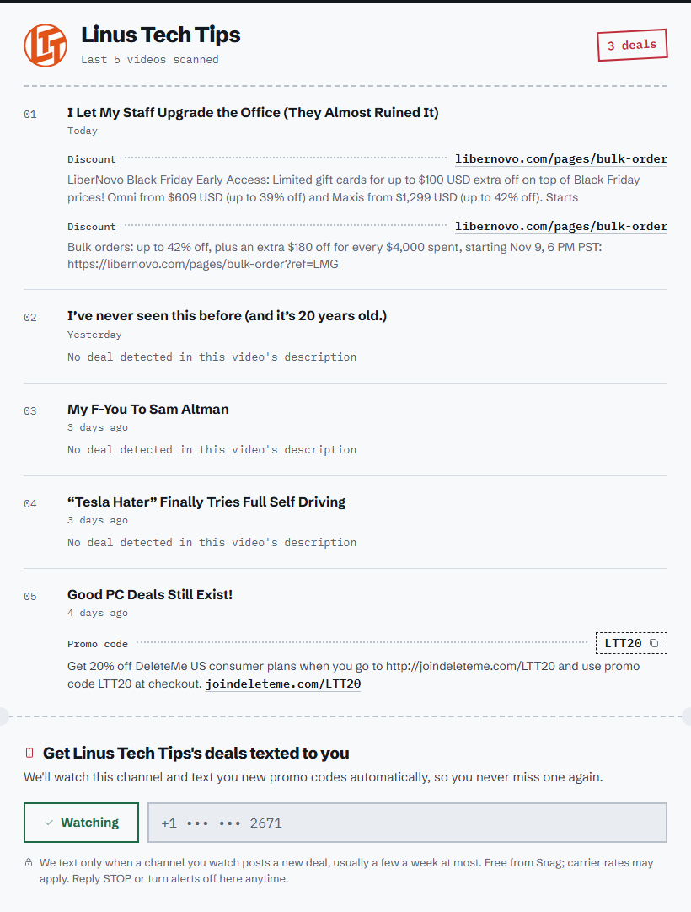
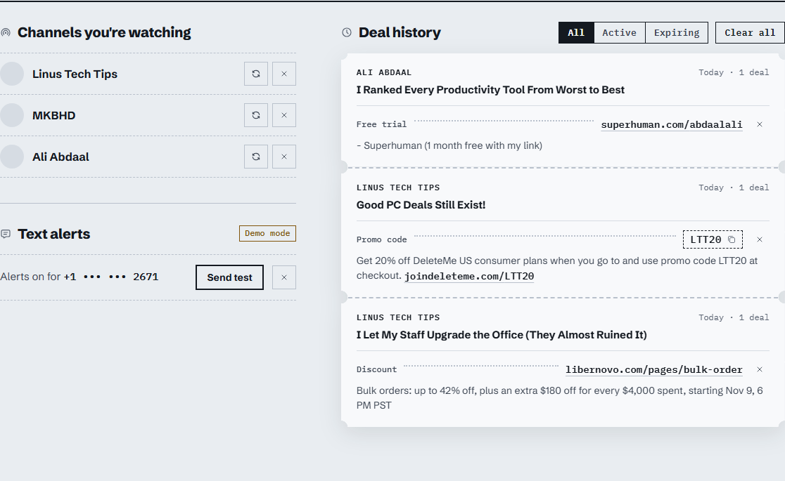
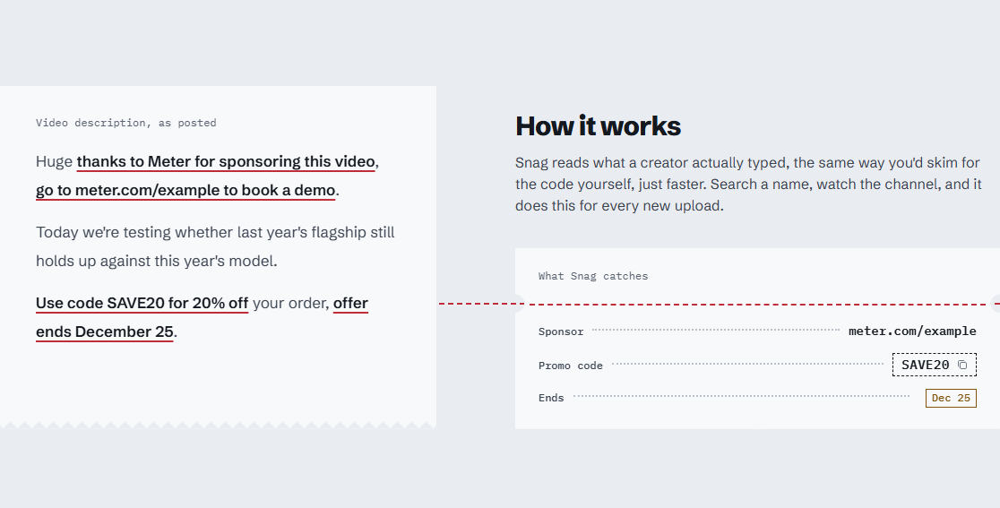
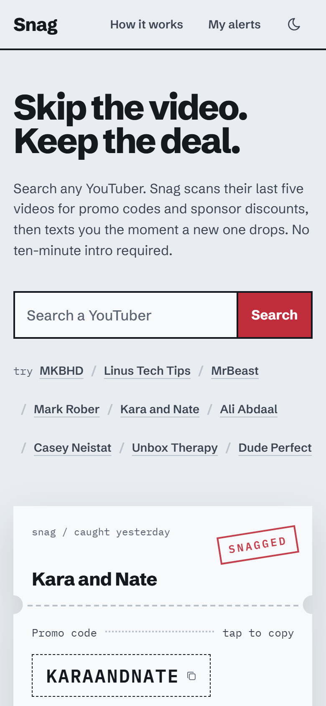
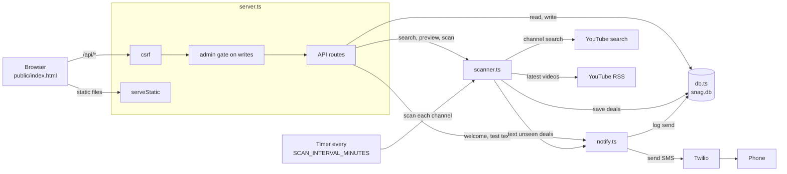
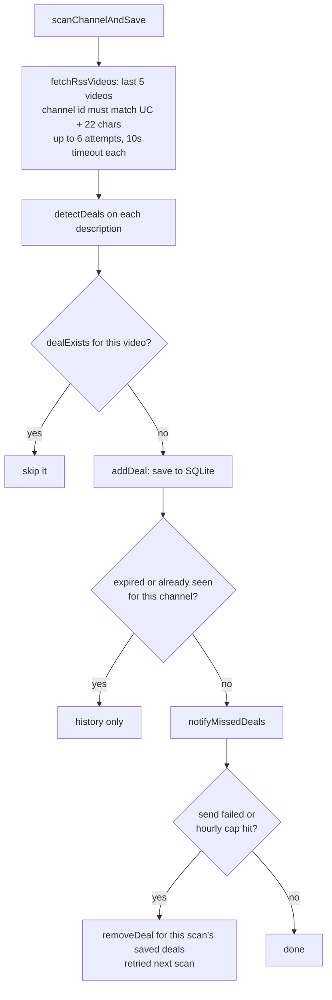

# Snag

Find the promo codes and deals buried in YouTube video descriptions, without watching the video.

**Live demo:** [snag-2232.onrender.com](https://snag-2232.onrender.com) *(free tier, first load may take ~30s to wake up)*


**Contents:** [Screenshots](#screenshots) · [Run it locally](#run-it-locally) · [Architecture](#architecture) · [How a video becomes a text](#how-a-video-becomes-a-text) · [API](#api) · [Configuration](#configuration) · [Security](#security) · [Testing](#testing) · [Deploying](#deploying) · [Why not serverless](#why-not-serverless-vercel)

## What it does

- **Search a YouTuber.** Type a name and pick the channel from the results.
- **See live catches.** The homepage shows a still strip of recent deals from a fixed set of well-known channels, so you can see the output before searching.
- **Preview before you commit.** See the deals found in the channel's last 5 videos: codes, sponsor links, and expiry dates.
- **Watch a channel and get texted.** Save a phone number and Snag texts you when a scan finds a new deal on a channel you watch. It re-scans every 30 minutes by default.
- **Browse deal history.** Every saved deal shows its video, code, and link. Expired deals are marked and can be filtered out.
- **Try it without Twilio.** If the Twilio variables are unset, Snag runs in demo mode: deals are still found and saved, and each text is logged to the server console instead of sent.

Snag supports one subscriber phone number per instance.

## Screenshots

| Channel preview | Your alerts and deal history |
|---|---|
|  |  |
| **How it works** | **Dark mode (opt in from the nav)** |
|  |  |

<p align="center"></p>

Light is the default. Dark mode only turns on when you pick it with the moon icon in the nav, and the choice is remembered in that browser.

## Run it locally

Requires [Bun](https://bun.sh).

```sh
bun install
bun run dev
```

Open http://localhost:4242. Run the tests with `bun test`.

## Architecture

Snag is one Bun process running a Hono app. The same process serves the static page, the JSON API, and a background timer that rescans watched channels. All state lives in one SQLite file. The only outbound calls go to YouTube (a search-page scrape and the channel RSS feed) and to Twilio.



### Project layout

```
src/
  server.ts        Hono app, middleware, routes, spotlight cache, scan timer
  scanner.ts       YouTube search scrape, RSS fetch, deal detection, scan and save
  db.ts            SQLite schema and queries (bun:sqlite)
  notify.ts        Phone handling, SMS text, Twilio send, hourly cap
  *.test.ts        Tests for db, scanner and server
public/
  index.html       The whole frontend: HTML, CSS and vanilla JS
docs/              Screenshots and the how-it-works image used in this README
render.yaml        Render deploy config
package.json       Scripts and dependencies (hono, @types/bun)
tsconfig.json      TypeScript settings
.gitignore         Ignores node_modules, .env, local SQLite files and logs
```

### Design decisions

- **One subscriber.** The `subscriber` table has `CHECK (id = 1)`, so it holds at most one row. Multi-user support means a schema change.
- **No build step.** The frontend is a single `index.html` with vanilla JS, served as is. Bun runs the TypeScript directly.
- **No YouTube API key.** Channel search scrapes the search results page and videos come from the public RSS feed. Both can break if YouTube changes its markup.
- **State that resets on restart.** The spotlight cache (10 minutes) and the SMS hourly cap (`SMS_MAX_PER_HOUR`, default 20) are in memory only.

## How a video becomes a text



`detectDeals` works in this order:

1. Return nothing for an empty description.
2. `findPartnerListDeals` reads the first block under a "Channel Partners" or "Our Sponsors" header and makes a "Sponsor" deal for each "Name - text: link" line, skipping social domains.
3. `parseExpiry` finds one date near a trigger word such as "ends" or "until". `validDate` rejects impossible dates like Feb 30.
4. `PROMO_RULES` run in order: promo code, discount code, discount, free trial, giveaway, limited offer, exclusive deal, sponsor.
5. `findDealUrl` pairs each match with a link on the same line, else the nearest within 300 characters. A "Sponsor" match with no link is dropped.
6. Codes must already be uppercase, so "code below" is ignored.
7. Dedupe by code or context, keeping code-bearing deals first.

### Known limits

The rules are regex heuristics, so they miss unusual phrasing and can match the wrong text. One expiry date is applied to every deal in a description. While Twilio keeps failing, new deals are deleted from history and will not appear there until a send succeeds. `previewChannel` never saves or texts.

## API

| Method | Path | What it does | Request body | Texts? |
|---|---|---|---|---|
| GET | `/api/search?q=` | Channel suggestions for a name (needs 2+ characters) | | |
| GET | `/api/channel/:id/preview` | Last 5 videos of a channel with detected deals, read-only | | |
| GET | `/api/spotlight` | Up to 12 recent deals from a fixed set of well-known channels, read-only | | |
| GET | `/api/deals` | Saved deals | | |
| DELETE | `/api/deals/:id` | Remove a deal | | |
| GET | `/api/channels` | Watched channels | | |
| POST | `/api/channels` | Watch a channel, scan it, return `newDeals` | `{ id, name?, thumbnail? }` | can |
| DELETE | `/api/channels/:id` | Stop watching a channel | | |
| POST | `/api/channels/:id/scan` | Scan one channel now (optional `?name=`) | | can |
| GET | `/api/sms` | Subscriber state, masked phone, whether SMS and the admin gate are on | | |
| POST | `/api/sms/subscribe` | Save the number and send a welcome text | `{ phone }` | yes |
| POST | `/api/sms/toggle` | Turn alerts on or off | `{ enabled }` | |
| DELETE | `/api/sms` | Remove the subscriber | | |
| POST | `/api/sms/test` | Send a test text with the latest deals | | yes |

Notes:

- Every non-GET route goes through the admin gate (see Security).
- Writes must come from the page's own origin; other sites are rejected by the CSRF check.
- Errors are JSON `{ error }` with a 4xx or 5xx status.
- `/api/spotlight` is cached for 10 minutes, and concurrent requests share one fetch.

```sh
curl -X POST http://localhost:4242/api/channels \
  -H "Authorization: Bearer $ADMIN_TOKEN" \
  -H "Origin: http://localhost:4242" \
  -H "Content-Type: application/json" \
  -d '{ "id": "UCXuqSBlHAE6Xw-yeJA0Tunw" }'
```

## Configuration

| Variable | Default | What it does |
|---|---|---|
| `PORT` | `4242` | Port the HTTP server listens on. |
| `SCAN_INTERVAL_MINUTES` | `30` | Minutes between background scans of watched channels. |
| `SNAG_DB_PATH` | `./snag.db` | Path of the SQLite database file. |
| `TWILIO_ACCOUNT_SID` | unset | Twilio account SID. |
| `TWILIO_AUTH_TOKEN` | unset | Twilio auth token. |
| `TWILIO_FROM_NUMBER` | unset | Twilio sender number. All three Twilio variables must be set to send real texts. Otherwise texts are only logged (demo mode). |
| `ADMIN_TOKEN` | unset | Bearer token required for all write requests (see Security). |
| `SMS_MAX_PER_HOUR` | `20` | Cap on real texts sent per rolling hour. An invalid or negative value falls back to 20. `0` blocks all real sends. |

## Security

Write requests (anything but GET) pass through this gate:

| `ADMIN_TOKEN` | Twilio | Result |
|---|---|---|
| unset | unset | Writes are open. This is demo mode, and texts are only logged. |
| unset | set | All writes get 401 until a token is set on the server. |
| set | any | Writes need `Authorization: Bearer <token>`. The page prompts for the token once and keeps it in `localStorage`. |

- `SMS_CONFIGURED` is read once at startup, so restart the server after adding Twilio keys.
- `csrf()` guards `/api/*`, and the server sends no CORS headers. The frontend is same-origin.
- The page runs every server value through `escapeHtml` and every link through `safeUrl`, which allows only `http` and `https`.
- Channel ids must match `UC` plus 22 characters (`[\w-]`). Avatar URLs must start with `https://yt3.ggpht.com/` or `https://yt3.googleusercontent.com/`, otherwise no avatar is stored.
- Phone numbers are masked in API responses.
- Real texts are capped at `SMS_MAX_PER_HOUR` (the counter is in memory and resets on restart), and each body is cut to 1600 characters.
- Snag stores exactly one subscriber. On a public deploy with real SMS, only the owner (the token holder) should subscribe.

## Testing

```
bun test
```

There are three test files in `src/`:

- `db.test.ts` covers the SQLite layer: channels, deals, the subscriber, notifications, and persistence across reopened files.
- `scanner.test.ts` covers deal detection, RSS fetching with retries, phone normalizing and masking, SMS text and sending, texting after a scan, subscriber-count parsing, and channel search ranking.
- `server.test.ts` covers the admin token: GET requests pass, and non-GET requests need the right bearer token.

Tests that touch the network replace `fetch` with a stub, and the database tests use temporary SQLite files that are deleted afterward, so `bun test` makes no network calls. End-to-end browser tests are not in the repo yet.

## Deploying

Snag needs a host that keeps one process running. It scans in the background and sends texts, so static hosts like GitHub Pages will not work.

A [render.yaml](render.yaml) blueprint is included. On Render:

1. Create an account at [render.com](https://render.com) and connect your GitHub.
2. Click **New > Blueprint**, pick this repo, and deploy.
3. Set `ADMIN_TOKEN` (any long random string) together with `TWILIO_ACCOUNT_SID`, `TWILIO_AUTH_TOKEN`, and `TWILIO_FROM_NUMBER`. Without Twilio, Snag runs in demo mode. Once Twilio is on, `ADMIN_TOKEN` is required or all changes are rejected.

Free-tier notes:

- The service sleeps after 15 minutes idle, so background scans pause while it sleeps.
- The SQLite file resets on restart.
- To keep data, add a persistent disk (paid) and point `SNAG_DB_PATH` at it, or use a hosted database.

## Why not serverless (Vercel)

The `setInterval` scan loop and the local SQLite file both assume one long-lived process. On Vercel you would replace the timer with a Vercel Cron Job that calls a scan endpoint (today the API only scans one channel per request, so you would add one that scans all). You would also replace the file with a hosted database such as Turso or Postgres. Render, Railway, and Fly run Snag unchanged.
